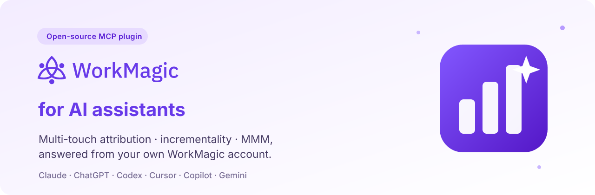

# WorkMagic for AI assistants

<p align="center">
  
</p>

**Ask your marketing measurement data anything — in Claude, ChatGPT, Codex, Cursor, Copilot or Gemini.**
Attribution by channel and campaign, why a number moved, lift test results and media budget
plans, answered from your own WorkMagic account.

[](#claude-claudeai-desktop-cowork)
[](#chatgpt-cursor-github-copilot)
[](#codex)
[](#chatgpt-cursor-github-copilot)
[](#gemini-cli)
[](#any-other-mcp-client)
[](LICENSE)
[](https://www.linkedin.com/company/workmagic-io/)

> ⭐ **Star this repo** to follow new skills and platforms as they ship — see the [changelog](CHANGELOG.md).

## What is WorkMagic

[WorkMagic](https://www.workmagic.io/solutions/mcp?utm_source=github&utm_medium=referral&utm_campaign=agent-plugin&utm_content=readme-intro)
is an AI-powered marketing measurement platform for ecommerce and DTC brands. It brings
multi-touch attribution (MTA), incrementality (geo lift tests) and media mix modeling (MMM) /
budget planning together — across Meta, Google, TikTok and more — so you can see what's actually
driving sales and decide where to spend next.

This **open-source (MIT) plugin** lets your AI assistant ask that same data questions in plain
language, using your own WorkMagic account — an open-source MCP server plus skills for marketing
attribution, incrementality and MMM.

## See it in action

> **You:** Compare Meta and Google attributed revenue under data-driven, last click, first click and
> any-click attribution for the last 30 days, and explain why they differ.
>
> **Claude:** *(abridged — WorkMagic demo store, synthetic data)*
>
> | Channel | Data-driven | Last click | First click | Any click |
> |---|---|---|---|---|
> | Meta | $10.2K | $17.3K | $27.1K | $38.0K |
> | Google | $12.7K | $19.9K | — | $33.2K |
>
> Meta looks strongest under first- and any-click because it starts most journeys: shoppers first
> arrive from a Meta ad, then come back through Google or direct before buying. Data-driven
> attribution splits each order's credit across those touchpoints, so both channels shrink. Any-click
> gives every touched channel full credit, which is why the two any-click figures add up to more
> than the store actually sold ($46.9K).

More sample conversations: [readiness check](examples/readiness-check.md) ·
[model comparison](examples/model-comparison.md) · [best-selling products](examples/best-sellers.md)

## What's included

The plugin has two parts: the **WorkMagic MCP server** (`https://mcp.workmagic.io/mcp`), which
reads and updates your WorkMagic account after you sign in, and nine **skills** that tell the
assistant how to use it well.

| Skill | Use it when you want to |
|---|---|
| `attribution-data-query` | Get attribution numbers — ROAS, CAC, revenue, orders by channel, campaign or period |
| `attribution-intent-clarification` | Ask a vague question; the assistant asks one focused follow-up, then answers |
| `attribution-model-comparison` | See iDDA, DDA, last-click and platform-reported numbers side by side, and why they differ |
| `attribution-anomaly-diagnosis` | Understand why attribution dropped, spiked or shows zero |
| `attribution-custom-dimension` | Break results down by audience, region, brand or another label in your campaign names |
| `attribution-edge-routing` | Get pointed to the right place when a question is outside attribution |
| `lift-test-readout` | Interpret a completed lift test (incremental ROAS, confidence) and decide what to do next |
| `mbo-read-scenario` | Read, compare or reconcile a Media Budget Optimizer scenario |
| `mbo-create-scenario` | Ask "how should I split my budget?" and get a configured MBO scenario |

Try asking:

- "What was my Meta ROAS last week?"
- "Why did Google attribution drop on Tuesday?"
- "Which products sold the most in the last 30 days?"
- "How should I split a $200K budget next month?"
- "Is my account ready to run a Meta lift test?"

## Get WorkMagic

Using this plugin needs an active WorkMagic account.

- **New to WorkMagic?** See [plans and pricing](https://www.workmagic.io/pricing?utm_source=github&utm_medium=referral&utm_campaign=agent-plugin&utm_content=readme-pricing)
  to get started.
- **Already a customer?** [Install](#install) below and sign in with your WorkMagic account the
  first time the assistant uses it.

Questions about plans? Contact your WorkMagic CSM or [support@workmagic.io](mailto:support@workmagic.io).
Lift test and budget optimizer skills need those features enabled on your account.

## Install

### Claude (claude.ai, desktop, Cowork)

1. Open plugin settings (**Settings → Plugins**, or **Plugins & skills**), choose **Add marketplace
   → GitHub repo**, enter `workmagicio/workmagic-agent-plugin`, then install **WorkMagic**.
   *(Listing in the Claude plugin directory is coming soon.)*
2. Open the plugin's **Connectors** tab and connect **WorkMagic**.

Only want the data connection? Add `https://mcp.workmagic.io/mcp` under **Customize > Connectors**
as a custom connector.

### Claude Code

```
/plugin marketplace add workmagicio/workmagic-agent-plugin
/plugin install workmagic@workmagic-plugins
```

### Codex

```
codex plugin marketplace add workmagicio/workmagic-agent-plugin
```

Then install `workmagic` from `/plugins`.

### Gemini CLI

```
gemini extensions install https://github.com/workmagicio/workmagic-agent-plugin
```

### ChatGPT, Cursor, GitHub Copilot

Directory listings are coming soon. Until then, connect the MCP server below; in Cursor you can also
add this repository as a team marketplace.

### Any other MCP client

Add `https://mcp.workmagic.io/mcp` as a remote (Streamable HTTP) MCP server. You get the tools;
the skills in [`skills/`](skills/) are plain Markdown you can load as instructions.

The first time the assistant uses WorkMagic, sign in with your WorkMagic account. If you belong to
several WorkMagic accounts, the assistant asks which one to use. Don't have an account yet? See
[Get WorkMagic](#get-workmagic) above.

## Data

The skills are instructions only; they don't run code or contact any other service. The assistant
reaches your data through the WorkMagic MCP server at `https://mcp.workmagic.io/mcp`, using the
account you sign in with. The server receives the requests the assistant makes on your behalf, such
as queries, filters and settings you ask to change, and returns your WorkMagic data. WorkMagic
logs those requests for security and support. Nothing is sent anywhere else.

Some skills can change settings in your WorkMagic account, such as creating or editing a budget
scenario. The assistant shows what it will change and asks you to confirm first.

The `tools/` folder holds scripts WorkMagic uses to maintain this repository. The plugin never runs
them.

## Follow WorkMagic

New skills, platforms and product updates ship often — follow along:

- [LinkedIn](https://www.linkedin.com/company/workmagic-io/)
- [Instagram](https://www.instagram.com/workmagic.io/)
- [Facebook](https://www.facebook.com/workmagic.io)
- ⭐ [Star this repo](https://github.com/workmagicio/workmagic-agent-plugin) and watch [releases](https://github.com/workmagicio/workmagic-agent-plugin/releases) for new versions.

## Support

Contact your WorkMagic CSM or [support@workmagic.io](mailto:support@workmagic.io). Privacy policy: [www.workmagic.io/privacy](https://www.workmagic.io/privacy?utm_source=github&utm_medium=referral&utm_campaign=agent-plugin&utm_content=readme-privacy).
Found a problem with a skill? [Open an issue](https://github.com/workmagicio/workmagic-agent-plugin/issues).
